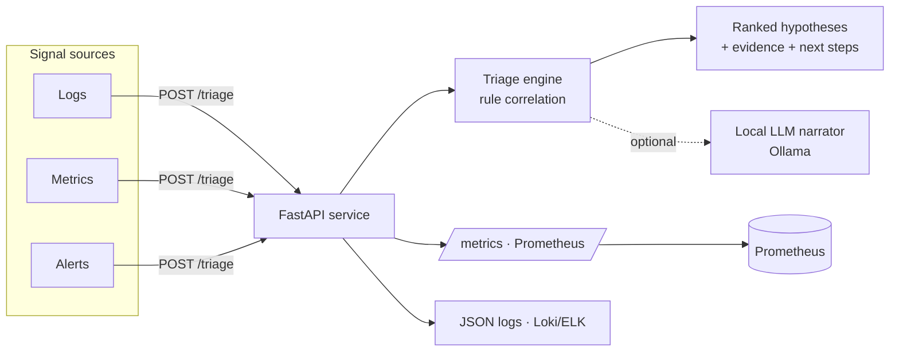

# aiops-incident-copilot

[](https://github.com/ArmandoSNHU/aiops-incident-copilot/actions/workflows/ci.yml)
[](https://www.python.org/)
[](#run-it-docker-compose)
[](#kubernetes)

**Turn a pile of incident signals into a ranked, evidence-cited root-cause call — in under a second, offline.**

When an alert fires, an on-call engineer scrolls logs and dashboards trying to connect the dots by hand. This service does the correlation: feed it the recent logs, metrics, and alerts for an incident and it returns the most likely causes, ranked, **each one backed by the exact evidence it matched and the next steps to take**. It runs as a real HTTP service with health checks and Prometheus metrics, containerized and ready for Kubernetes.

The problem → the shape of the fix:

| Operational problem | This system |
| --- | --- |
| Signals are scattered across logs, metrics, and alerts | One `/triage` call takes them all as structured input |
| Triage is manual and depends on who's on call | A deterministic rule engine correlates them the same way every time |
| "The model said so" isn't good enough at 3 a.m. | Every hypothesis cites the evidence that produced it |
| A demo isn't a system | Health checks, Prometheus metrics, JSON logs, Docker, and K8s manifests |

## What it produces

Real output from `python -m aiops.sample` — a checkout outage with five mixed signals:

```json
{
  "incident_id": "INC-2043",
  "summary": "Analyzed 5 signal(s). Most likely cause: Database connection pool exhaustion (confidence 71%), backed by 2 piece(s) of evidence. Recommended first step: Check active vs. max DB connections and recent connection growth.",
  "signal_count": 5,
  "hypotheses": [
    {
      "cause": "Database connection pool exhaustion",
      "confidence": 0.71,
      "evidence": [
        {"source": "checkout-svc", "detail": "TimeoutError: timeout acquiring connection from pool"},
        {"source": "postgres", "detail": "db_connections_active=98.0 (>90)"}
      ],
      "next_steps": [
        "Check active vs. max DB connections and recent connection growth.",
        "Look for a slow query or a leaked connection holding the pool.",
        "Temporarily raise pool size / add a read replica if saturation is real."
      ]
    },
    { "cause": "Upstream dependency failing (5xx)", "confidence": 0.69, "...": "..." },
    { "cause": "Latency / saturation",            "confidence": 0.68, "...": "..." }
  ]
}
```

The 502s were a symptom; the copilot ranks the **connection-pool exhaustion** underneath them first, because two independent signals point at it.

## Architecture



- **Deterministic core** — a rule engine (`aiops/rules.py`) matches keyword patterns in logs/alerts and thresholds on metrics. Explainable and testable, no model required.
- **Optional LLM narrator** — set `AIOPS_MODE=ollama` and the summary is written by a local model; the ranking and evidence stay deterministic.
- **Observability built in** — `/metrics` (Prometheus) and structured JSON logs, so it drops into a real monitoring stack.

## Run it (docker compose)

Brings up the API and a Prometheus that scrapes it:

```bash
docker compose up --build
# API docs   -> http://localhost:8000/docs
# Prometheus -> http://localhost:9090   (query: aiops_triage_requests_total)
```

Triage the sample incident:

```bash
curl -s localhost:8000/triage \
  -H "content-type: application/json" \
  -d @examples/sample_incident.json | python -m json.tool
```

## Run it (local Python)

```bash
pip install -r requirements.txt
uvicorn aiops.server:app --port 8000
# or just see a triage result with no server:
python -m aiops.sample
```

## Kubernetes

Manifests in [`deploy/k8s/`](deploy/k8s) — a 2-replica Deployment with liveness/readiness
probes on `/health`, resource requests/limits, a ConfigMap, a Service, and a CPU
HorizontalPodAutoscaler (2–10 replicas). Pods carry `prometheus.io/scrape` annotations.

```bash
kubectl apply -f deploy/k8s/
kubectl get pods -l app=aiops
```

## API

| Method | Path | Purpose |
| --- | --- | --- |
| `GET` | `/health` | Liveness/readiness — status, version, mode |
| `GET` | `/metrics` | Prometheus exposition (request counts, triage latency histogram) |
| `POST` | `/triage` | Body: an `Incident`; returns ranked `TriageResult` |
| `GET` | `/docs` | Auto-generated OpenAPI UI |

## How ranking works

Each rule contributes a hypothesis when it matches. Confidence is bounded and
explainable — a prior weight for the cause plus a bump per piece of evidence,
capped at 0.95 — so more corroborating signals raise confidence without ever
pretending to be certain. Hypotheses are sorted by confidence, ties broken by
evidence count. Adding a cause is one entry in `RULES`; the API and tests don't change.

## Project structure

```text
aiops/
  models.py          Signal, Incident, Hypothesis, TriageResult (pydantic)
  rules.py           correlation rules (keywords + metric thresholds)
  triage.py          TriageEngine: correlate -> rank -> summarize
  llm.py             PlainNarrator (offline) + OllamaNarrator
  metrics.py         Prometheus counters + histograms
  logging_config.py  structured JSON logging
  server.py          FastAPI app: /health, /metrics, /triage
  sample.py          runnable demo incident
deploy/
  prometheus.yml     scrape config used by docker compose
  k8s/               Deployment, Service, ConfigMap, HPA
examples/            sample incident payload
tests/               pytest suite (rules, ranking, and the API)
Dockerfile           non-root, healthchecked image
docker-compose.yml   app + Prometheus
```

## Tests

```bash
pip install -r requirements.txt pytest httpx
pytest -q          # 9 tests: rule matching, ranking, and the live API
```

CI runs the same suite on every push.

## Limitations & next steps

- The rule set is a starter library of common failure modes; it is meant to be extended per environment.
- Correlation is pattern-based, not causal inference — it points at the most-corroborated cause, which a human still confirms.
- A natural next step is wiring `/triage` to a real alert source (Alertmanager webhook) and shipping the JSON logs to Loki with a Grafana panel over the exposed metrics.
